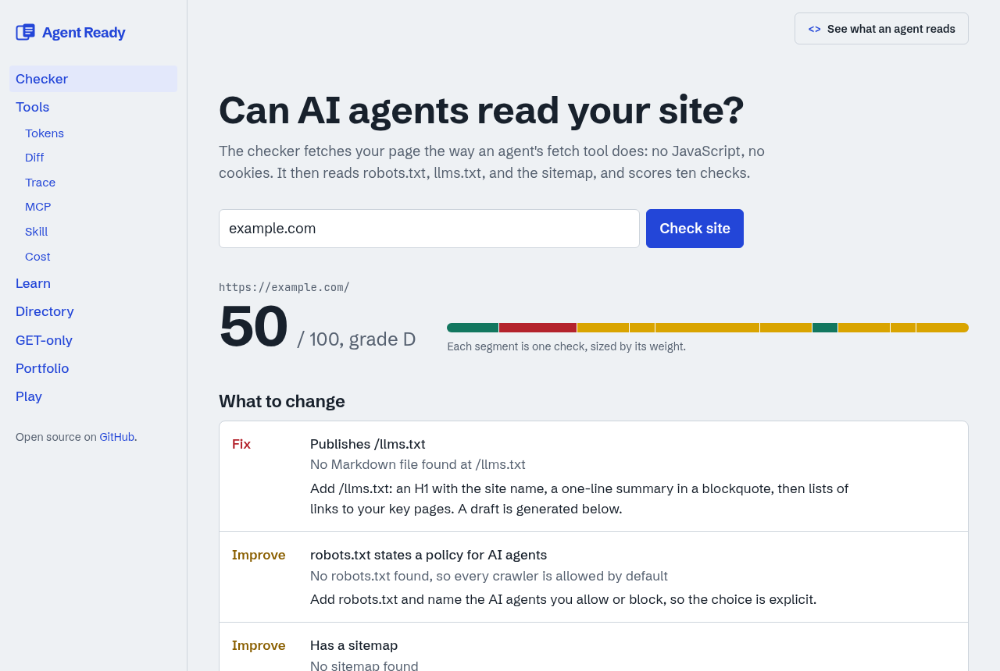

# Agent Ready

**あなたのサイトは AI エージェントに読めますか?** URL を入れるだけで、修正リスト、`llms.txt` の下書き、README 用バッジが手に入ります。エージェントを作る人のための、ブラウザだけで動く小さなツールも揃っています。

[English](README.md) | 日本語

[](https://vercel.com/new/clone?repository-url=https%3A%2F%2Fgithub.com%2Fblk69912%2Fwebsite)



## 中身

| ページ | できること |
|--------|-----------|
| `/check` | エージェントの fetch ツールと同じ条件でページを取得し、10項目を採点します。`llms.txt` の下書きとバッジも出します。 |
| `/tools` | トークン推定、プロンプト差分、JSONL トレースビューア、MCP 検証、`SKILL.md` の lint、料金見積もり。入力はブラウザの外に出ません。 |
| `/learn` | ツールを使うエージェントの1回の実行をステップごとに追い、コンテキストウィンドウが埋まる様子を見られます。日英対応。 |
| `/directory` | MCP サーバー、Agent Skills、エージェント対応 Web のプロジェクト一覧。GitHub のスター数を自動同期します。 |
| `/get` | GET リクエストだけで使える KV、カウンタ、メモ、ペースト。Web fetch しか許されないサンドボックスのエージェント向けです。 |
| `/portfolio` | ポートフォリオのテンプレート。JSON 1ファイルからページ、`/resume.json`、JSON-LD、`llms.txt` を生成します。 |
| `/play` | HTTP ステータスコード当てクイズと、プロンプトインジェクション見破りゲーム。 |

**このサイト自身が診断基準を満たしています。** 全ページに Markdown 版があり、`Accept: text/markdown` で取得できます。画面右上の「See what an agent reads」でも確認できます。

## 自分のプロジェクトにバッジを付ける

```markdown
[](https://<デプロイ先>/check?url=your-site.com)
```

## ローカルで動かす

Node.js 22 以上が必要です。

```bash
npm install
npm run dev        # http://localhost:3000
npm test
```

GET 専用サービスのデータを永続化するには、Upstash Redis の `KV_REST_API_URL` と `KV_REST_API_TOKEN` を設定します。未設定ならメモリに保存され、再起動で消えます。Vercel では Marketplace から Upstash Redis を追加すると自動で設定されます。

## コントリビュート

PR 歓迎です。最初の一歩におすすめなのは次の3つです。

- [`data/directory.json`](data/directory.json) にプロジェクトを1行追加する。
- [クイズやゲームの問題](src/content/games.ts)を追加する。
- ツールを追加する。`src/lib` に純粋関数、`src/app/tools` にページ、テストを1つずつ。

## ライセンス

MIT
