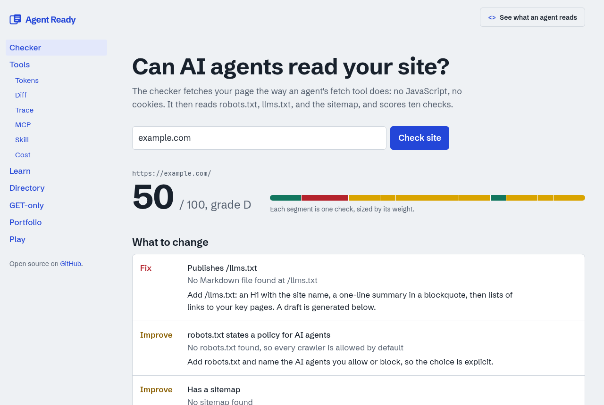

# Agent Ready

**Is your site readable by AI agents?** Check any URL, get a fix list, a draft `llms.txt`, and a README badge. Plus a set of small, browser-only tools for people who build agents.

English | [日本語](README.ja.md)

[](https://vercel.com/new/clone?repository-url=https%3A%2F%2Fgithub.com%2Fblk69912%2Fwebsite)
[](https://github.com/blk69912/website/actions/workflows/ci.yml)
[](LICENSE)



## What's inside

| Page | What it does |
|------|--------------|
| `/check` | Fetches a page the way an agent's fetch tool does, scores 10 checks, drafts an `llms.txt`, and gives you a badge. |
| `/tools` | Token estimator, prompt diff, JSONL trace viewer, MCP validator, `SKILL.md` linter, cost estimator. Nothing leaves your browser. |
| `/learn` | Step through one tool-calling agent run and watch the context window fill. English and Japanese. |
| `/directory` | MCP servers, Agent Skills, and agent-ready web projects with live GitHub stars. Add one with a one-line PR. |
| `/get` | Key-value, counters, notes, and pastes over plain `GET`, for agents whose sandbox only allows web fetch. |
| `/portfolio` | A portfolio template. One JSON file feeds the page, `/resume.json`, JSON-LD, and `llms.txt`. |
| `/play` | Guess the HTTP status code. Spot the prompt injection. |

**The site practices what it checks.** Every page has a Markdown twin. Send `Accept: text/markdown` to any URL, or press "See what an agent reads" in the corner.

```bash
curl -H "Accept: text/markdown" https://<your-deployment>/check
curl https://<your-deployment>/llms.txt
```

## Add the badge to your project

```markdown
[](https://<deployment>/check?url=your-site.com)
```

## The checks

| Check | Weight | Why it matters |
|-------|-------:|----------------|
| Content in the HTML | 20 | Most fetch tools do not run JavaScript. |
| `/llms.txt` | 15 | A curated map of your site, written for models. |
| Plain GET works | 10 | Bot walls and cookie gates stop agents cold. |
| robots.txt policy for AI agents | 10 | Makes your choice explicit, and catches accidental blocks. |
| Title and description | 10 | The first thing a summary is built from. |
| JSON-LD | 10 | Typed facts beat scraped guesses. |
| Markdown on request | 10 | Fewer tokens, cleaner context. |
| Sitemap | 5 | Lets agents find the rest. |
| `lang` attribute | 5 | Picks the right language for quotes and answers. |
| One H1 | 5 | Tells the summary where the page starts. |

A warning scores half. The API is open to agents and CI:

```bash
curl "https://<deployment>/api/check?url=example.com&format=md"   # Markdown report
curl "https://<deployment>/api/check?url=example.com"             # JSON
```

## Run it locally

Requires Node.js 22 or later.

```bash
npm install
npm run dev        # http://localhost:3000
npm test           # unit tests
npm run lint
npm run build
```

### Optional configuration

| Variable | Purpose |
|----------|---------|
| `NEXT_PUBLIC_SITE_URL` | Absolute URL used in `llms.txt`, the sitemap, and metadata. On Vercel the production URL is used automatically. |
| `KV_REST_API_URL`, `KV_REST_API_TOKEN` | Upstash Redis for the GET-only services. The `UPSTASH_REDIS_REST_*` names also work. Without them, data lives in memory and is lost on restart. |

On Vercel, add Upstash Redis from the Marketplace and the variables are set for you.

## How it is built

- Next.js App Router with Cache Components. Pages prerender; the checker and GET services run on demand.
- `src/proxy.ts` rewrites requests that prefer `text/markdown` to the Markdown twins in `src/app/md`.
- `src/content/site.ts` is the single registry for navigation, sitemap, `llms.txt`, and Markdown twins.
- The checker blocks private, loopback, and link-local addresses, re-validates every redirect hop, and caps responses at 1.5 MB.
- All tool logic lives in `src/lib` as pure functions with tests in `tests/`.

## Contributing

Pull requests are welcome. Good first contributions:

- Add a project to [`data/directory.json`](data/directory.json).
- Add a round to the [status quiz or injection game](src/content/games.ts).
- Add a tool: one pure function in `src/lib`, one page in `src/app/tools`, one test.

See [CONTRIBUTING.md](CONTRIBUTING.md).

## License

MIT
